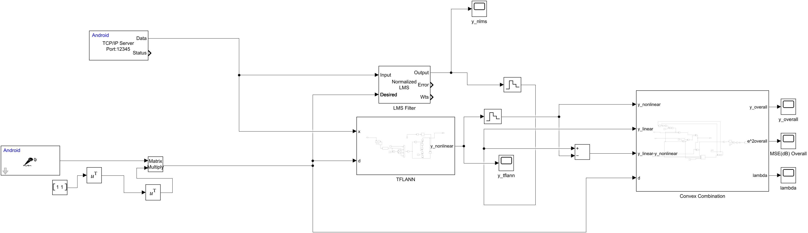
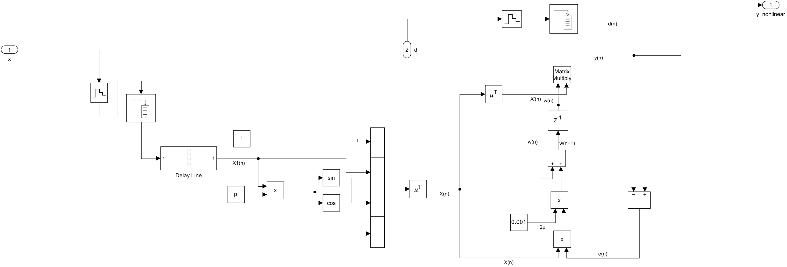
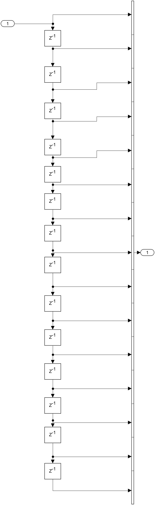

# Real-Time Convex Combination of Adaptive Filters on Android

Advanced Signal Processing (IIT Gandhinagar), Assignment 3 — April 2026.
Authors: **Vishrut Sharma** and **Vikash Kumar Sinha**.

A real-time adaptive filtering system built in Simulink and deployed to two Android phones.
An **NLMS** filter and a **TFLANN** (trigonometric functional link artificial neural network)
run side by side, and an adaptive **convex combination** mixes their outputs so the result
follows whichever filter is doing better at each moment.

## How it works

- **Input x(n):** Phone A streams its microphone signal over TCP/IP; Phone B receives it with an
  Android **TCP/IP Server** block (port 12345).
- **Desired signal d(n):** Phone B's own microphone (Android Audio Capture; the two channels are
  summed into one).
- **Linear branch:** DSP System Toolbox *LMS Filter* block in **Normalized LMS** mode → `y_linear`.
- **Nonlinear branch:** the `TFLANN` subsystem → `y_nonlinear`.
- **Convex combination:** the `Convex Combination` subsystem → `y_overall`, `λ` and the smoothed
  squared error in dB.

### TFLANN subsystem

A 15-sample tap-delay line X₁(n) (below) is expanded functionally into
X(n) = [1, X₁(n), sin(πX₁(n)), cos(πX₁(n))], so a filter that is linear in its weights can model
a nonlinear system. The weights are trained with the LMS rule

    y(n) = wᵀ(n) X(n),   e(n) = d(n) − y(n),   w(n+1) = w(n) + 2μ e(n) X(n),   2μ = 0.001

### Convex Combination subsystem

    λ(n) = 1 / (1 + e^(−a(n)))
    y(n) = λ(n) y_linear(n) + (1 − λ(n)) y_nonlinear(n)
    e(n) = d(n) − y(n)
    a(n+1) = sat[ a(n) + μ_a e(n) (y_linear(n) − y_nonlinear(n)) λ(n) (1 − λ(n)) ],   μ_a = 0.01

The sigmoid keeps λ between 0 and 1, and the saturation stops a(n) from running away (which
would freeze the mixing at 0 or 1). λ → 1 means the combination follows the NLMS branch,
λ → 0 the TFLANN branch. The squared error is smoothed with a moving average and a low-pass
filter and displayed in dB.

## Files

| File | What |
| --- | --- |
| `A3.slx` | Simulink model |
| `ASPA3.pdf` | Report: model, equations, setup and results |
| `images/` | Diagrams exported from the model |

## Requirements

MATLAB/Simulink with the DSP System Toolbox and the **Simulink Support Package for Android
Devices** (for deployment to the phones and for the Audio Capture and TCP/IP blocks).
